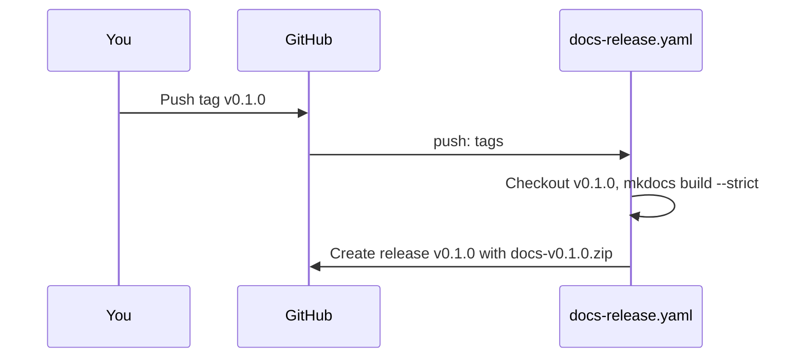

# Releases

Every release is created by the workflow `docs-release.yaml` from a pushed tag, with its
documentation attached as `docs-<tag>.zip`.

The release is published already complete because the repository uses
[immutable releases](https://docs.github.com/en/code-security/supply-chain-security/understanding-your-software-supply-chain/immutable-releases):
once published, a release and its assets cannot be changed.



## Create a release

Tag the commit and push the tag. Do not create the release on GitHub yourself: the workflow
could not attach the documentation to it.

```bash
git tag v0.1.0
git push origin v0.1.0
```

After a minute, the release page shows `docs-v0.1.0.zip`, with notes generated from the merged
pull requests. Download it, unzip it and open `index.html`.

## Links to the source code

Links from the docs to source files (for example [population.py](../../src/citystats/population.py))
and the "view source" button of each page point at the release tag, so they show the files as
they were in that release. The tag is also shown next to the site name. The hook
`docs/scripts/repo_links.py` reads the tag from the `DOCS_REF` environment variable and falls back
to `main`:

```bash
DOCS_REF=v0.1.0 uv run mkdocs build
```

## If the workflow failed

If the tag exists but the release was not created, run **Release** manually from the Actions tab
and enter the tag.

A release that is already published cannot be fixed: push a new tag, such as `v0.1.1`.
