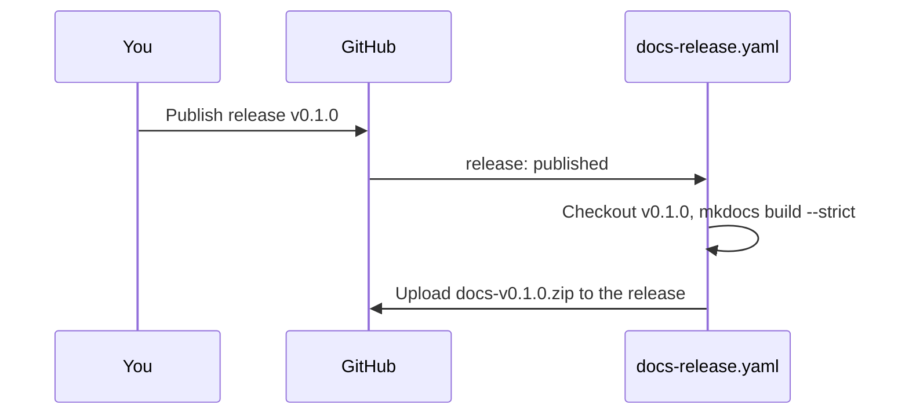

# Releases

Every published GitHub release gets its documentation attached as `docs-<tag>.zip`.



## Create a release

```bash
gh release create v0.1.0 --title "v0.1.0" --generate-notes
```

After a minute, the release page shows `docs-v0.1.0.zip`. Download it, unzip it and open
`index.html`.

## Links to the source code

Links from the docs to source files (for example [population.py](../../src/citystats/population.py))
and the "view source" button of each page point at the release tag, so they show the files as
they were in that release. The tag is also shown next to the site name. The hook
`docs/scripts/repo_links.py` reads the tag from the `DOCS_REF` environment variable and falls back
to `main`:

```bash
DOCS_REF=v0.1.0 uv run mkdocs build
```

## Re-attach the documentation

If the workflow failed, run **Release documentation** manually from the Actions tab and enter the
tag. The zip is replaced if it already exists.
