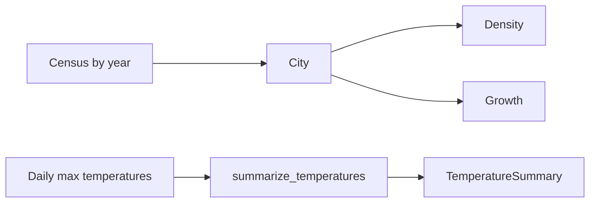

# Architecture

`citystats` has two independent modules, re-exported by the package:

[`citystats.population`][citystats.population]
:   Census data of a city: density and growth over time.

[`citystats.weather`][citystats.weather]
:   Summaries of daily maximum temperatures.

## Concepts

Density
:   Inhabitants per square kilometre, from the latest census unless a year is given.

CAGR
:   Growth rate per year as a fraction, e.g. `0.01` for 1 % a year, between two population
    counts.

Hot day
:   A day whose maximum temperature is at or above
    [`HOT_DAY_CELSIUS`][citystats.weather.HOT_DAY_CELSIUS] (30 °C).
