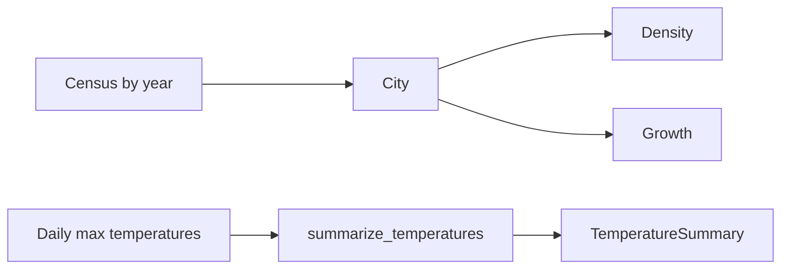

# Usage

## Population

A [`City`][citystats.population.City] holds the census counts by year and computes density and
growth:

```python
from citystats import City

madrid = City(
    name="Madrid",
    area_km2=604.3,
    population_by_year={2014: 3_165_000, 2024: 3_416_000},
)
madrid.density()  # inhabitants per km², latest census
madrid.growth_rate(2014, 2024)  # compound annual growth rate
```

The source is in [population.py](../src/citystats/population.py).

## Weather

[`summarize_temperatures`][citystats.weather.summarize_temperatures] turns daily maximum
temperatures into a [`TemperatureSummary`][citystats.weather.TemperatureSummary]:

```python
from citystats import summarize_temperatures

summary = summarize_temperatures([28.0, 31.5, 33.0, 29.9])
summary.average  # 30.6
summary.hot_days  # 2
```


